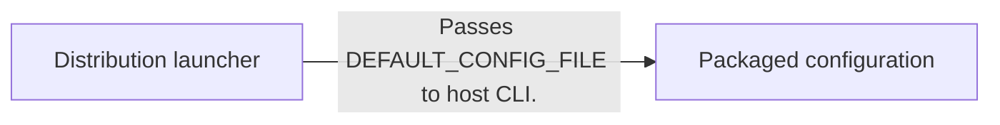
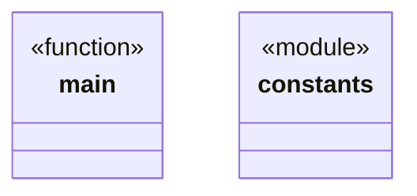
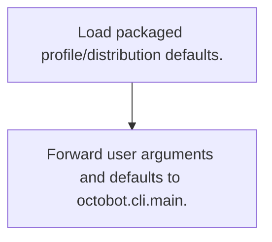
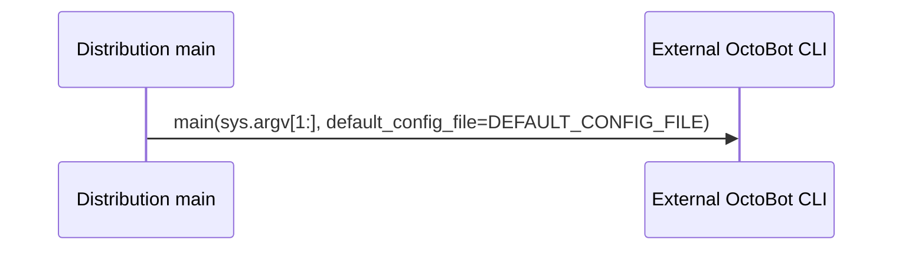

# OctoBot-Market-Making: workflow, design and architecture

Updated: **2026-10-13**
Reviewed Git hash: `21e0d4c21b4f6460e36113d5254cab55a22108ec`
Branch: `feature/ayu_develop`
Source diff SHA256: `e3b0c44298fc1c149afbf4c8996fb92427ae41e4649b934ca495991b7852b855`
Scope: **Distribution / configuration companion** / Maintenance: **companion**
Languages: Python

[HTML edition](ayu-develop.html) / [Development](development.md) / [Historical validation](validation.md) / [Full system comparison](../../docs/index.html)

## Purpose and scope

Launch the OctoBot host with the market_making distribution and selected profile; this repository does not contain the market-making order engine.

## Features and support boundaries

Native = implemented here. Integration = supplied through a named host/API. Limited = material restriction. Not provided = evidenced scope exclusion. Unverified = support/absence not established. Not applicable = outside this artifact type.

| Capability | Status | Implementation and limits | Source |
|---|---|---|---|
| Backtesting | Unverified | Packaged config contains an empty backtesting file list, which does not prove replay support for the selected market-making profile. Wrapper source only delegates startup to OctoBot; profile backtestability is not established here. | [src/octobot_market_making/config/default_config.json](../src/octobot_market_making/config/default_config.json) ([L23](https://github.com/alexcwyu/OctoBot-Market-Making/blob/21e0d4c21b4f6460e36113d5254cab55a22108ec/src/octobot_market_making/config/default_config.json#L23)) / [main](../src/octobot_market_making/cli.py) ([L22](https://github.com/alexcwyu/OctoBot-Market-Making/blob/21e0d4c21b4f6460e36113d5254cab55a22108ec/src/octobot_market_making/cli.py#L22)) |
| Live execution | Integration | Supplied by external OctoBot host and activated market_making profile/tentacles; local code only delegates startup. | [main](../src/octobot_market_making/cli.py) ([L22](https://github.com/alexcwyu/OctoBot-Market-Making/blob/21e0d4c21b4f6460e36113d5254cab55a22108ec/src/octobot_market_making/cli.py#L22)) / [src/octobot_market_making/config/default_config.json](../src/octobot_market_making/config/default_config.json) ([L23](https://github.com/alexcwyu/OctoBot-Market-Making/blob/21e0d4c21b4f6460e36113d5254cab55a22108ec/src/octobot_market_making/config/default_config.json#L23)) |
| Paper trading | Integration | Supplied by external OctoBot host and activated market_making profile/tentacles; local code only delegates startup. | [main](../src/octobot_market_making/cli.py) ([L22](https://github.com/alexcwyu/OctoBot-Market-Making/blob/21e0d4c21b4f6460e36113d5254cab55a22108ec/src/octobot_market_making/cli.py#L22)) / [src/octobot_market_making/config/default_config.json](../src/octobot_market_making/config/default_config.json) ([L23](https://github.com/alexcwyu/OctoBot-Market-Making/blob/21e0d4c21b4f6460e36113d5254cab55a22108ec/src/octobot_market_making/config/default_config.json#L23)) |
| Event driven | Unverified | Representative source review did not establish this capability; no claim of absence. | Not applicable to this repository scope. |
| Vectorized | Unverified | Representative source review did not establish this capability; no claim of absence. | Not applicable to this repository scope. |
| Order management | Integration | Supplied by external OctoBot host and activated market_making profile/tentacles; local code only delegates startup. | [main](../src/octobot_market_making/cli.py) ([L22](https://github.com/alexcwyu/OctoBot-Market-Making/blob/21e0d4c21b4f6460e36113d5254cab55a22108ec/src/octobot_market_making/cli.py#L22)) / [src/octobot_market_making/config/default_config.json](../src/octobot_market_making/config/default_config.json) ([L23](https://github.com/alexcwyu/OctoBot-Market-Making/blob/21e0d4c21b4f6460e36113d5254cab55a22108ec/src/octobot_market_making/config/default_config.json#L23)) |
| Order types | Integration | Supplied by external OctoBot host and activated market_making profile/tentacles; local code only delegates startup. | [main](../src/octobot_market_making/cli.py) ([L22](https://github.com/alexcwyu/OctoBot-Market-Making/blob/21e0d4c21b4f6460e36113d5254cab55a22108ec/src/octobot_market_making/cli.py#L22)) / [src/octobot_market_making/config/default_config.json](../src/octobot_market_making/config/default_config.json) ([L23](https://github.com/alexcwyu/OctoBot-Market-Making/blob/21e0d4c21b4f6460e36113d5254cab55a22108ec/src/octobot_market_making/config/default_config.json#L23)) |
| Multi venue | Integration | Supplied by external OctoBot host and activated market_making profile/tentacles; local code only delegates startup. | [main](../src/octobot_market_making/cli.py) ([L22](https://github.com/alexcwyu/OctoBot-Market-Making/blob/21e0d4c21b4f6460e36113d5254cab55a22108ec/src/octobot_market_making/cli.py#L22)) / [src/octobot_market_making/config/default_config.json](../src/octobot_market_making/config/default_config.json) ([L23](https://github.com/alexcwyu/OctoBot-Market-Making/blob/21e0d4c21b4f6460e36113d5254cab55a22108ec/src/octobot_market_making/config/default_config.json#L23)) |
| Crypto | Integration | Supplied by external OctoBot host and activated market_making profile/tentacles; local code only delegates startup. | [main](../src/octobot_market_making/cli.py) ([L22](https://github.com/alexcwyu/OctoBot-Market-Making/blob/21e0d4c21b4f6460e36113d5254cab55a22108ec/src/octobot_market_making/cli.py#L22)) / [src/octobot_market_making/config/default_config.json](../src/octobot_market_making/config/default_config.json) ([L23](https://github.com/alexcwyu/OctoBot-Market-Making/blob/21e0d4c21b4f6460e36113d5254cab55a22108ec/src/octobot_market_making/config/default_config.json#L23)) |
| Equities | Unverified | Representative source review did not establish this capability; no claim of absence. | Not applicable to this repository scope. |
| Futures | Unverified | Representative source review did not establish this capability; no claim of absence. | Not applicable to this repository scope. |
| Options | Unverified | Representative source review did not establish this capability; no claim of absence. | Not applicable to this repository scope. |
| Forex | Unverified | Representative source review did not establish this capability; no claim of absence. | Not applicable to this repository scope. |
| Strategy api | Integration | Supplied by external OctoBot host and activated market_making profile/tentacles; local code only delegates startup. | [main](../src/octobot_market_making/cli.py) ([L22](https://github.com/alexcwyu/OctoBot-Market-Making/blob/21e0d4c21b4f6460e36113d5254cab55a22108ec/src/octobot_market_making/cli.py#L22)) / [src/octobot_market_making/config/default_config.json](../src/octobot_market_making/config/default_config.json) ([L23](https://github.com/alexcwyu/OctoBot-Market-Making/blob/21e0d4c21b4f6460e36113d5254cab55a22108ec/src/octobot_market_making/config/default_config.json#L23)) |
| Optimization | Unverified | Representative source review did not establish this capability; no claim of absence. | Not applicable to this repository scope. |
| Machine learning | Unverified | Representative source review did not establish this capability; no claim of absence. | Not applicable to this repository scope. |
| Reinforcement learning | Unverified | Representative source review did not establish this capability; no claim of absence. | Not applicable to this repository scope. |
| Portfolio | Integration | Supplied by external OctoBot host and activated market_making profile/tentacles; local code only delegates startup. | [main](../src/octobot_market_making/cli.py) ([L22](https://github.com/alexcwyu/OctoBot-Market-Making/blob/21e0d4c21b4f6460e36113d5254cab55a22108ec/src/octobot_market_making/cli.py#L22)) / [src/octobot_market_making/config/default_config.json](../src/octobot_market_making/config/default_config.json) ([L23](https://github.com/alexcwyu/OctoBot-Market-Making/blob/21e0d4c21b4f6460e36113d5254cab55a22108ec/src/octobot_market_making/config/default_config.json#L23)) |
| Risk management | Integration | Supplied by external OctoBot host and activated market_making profile/tentacles; local code only delegates startup. | [main](../src/octobot_market_making/cli.py) ([L22](https://github.com/alexcwyu/OctoBot-Market-Making/blob/21e0d4c21b4f6460e36113d5254cab55a22108ec/src/octobot_market_making/cli.py#L22)) / [src/octobot_market_making/config/default_config.json](../src/octobot_market_making/config/default_config.json) ([L23](https://github.com/alexcwyu/OctoBot-Market-Making/blob/21e0d4c21b4f6460e36113d5254cab55a22108ec/src/octobot_market_making/config/default_config.json#L23)) |
| Performance analytics | Unverified | Representative source review did not establish this capability; no claim of absence. | Not applicable to this repository scope. |
| Historical data | Unverified | Representative source review did not establish this capability; no claim of absence. | Not applicable to this repository scope. |
| Streaming data | Integration | Supplied by external OctoBot host and activated market_making profile/tentacles; local code only delegates startup. | [main](../src/octobot_market_making/cli.py) ([L22](https://github.com/alexcwyu/OctoBot-Market-Making/blob/21e0d4c21b4f6460e36113d5254cab55a22108ec/src/octobot_market_making/cli.py#L22)) / [src/octobot_market_making/config/default_config.json](../src/octobot_market_making/config/default_config.json) ([L23](https://github.com/alexcwyu/OctoBot-Market-Making/blob/21e0d4c21b4f6460e36113d5254cab55a22108ec/src/octobot_market_making/config/default_config.json#L23)) |
| Persistence | Unverified | Representative source review did not establish this capability; no claim of absence. | Not applicable to this repository scope. |
| Data pipeline | Unverified | Representative source review did not establish this capability; no claim of absence. | Not applicable to this repository scope. |
| Web ui | Integration | Supplied by external OctoBot host and activated market_making profile/tentacles; local code only delegates startup. | [main](../src/octobot_market_making/cli.py) ([L22](https://github.com/alexcwyu/OctoBot-Market-Making/blob/21e0d4c21b4f6460e36113d5254cab55a22108ec/src/octobot_market_making/cli.py#L22)) / [src/octobot_market_making/config/default_config.json](../src/octobot_market_making/config/default_config.json) ([L23](https://github.com/alexcwyu/OctoBot-Market-Making/blob/21e0d4c21b4f6460e36113d5254cab55a22108ec/src/octobot_market_making/config/default_config.json#L23)) |
| Cli | Native | Distribution provides a CLI wrapper with packaged config resources. | [main](../src/octobot_market_making/cli.py) ([L22](https://github.com/alexcwyu/OctoBot-Market-Making/blob/21e0d4c21b4f6460e36113d5254cab55a22108ec/src/octobot_market_making/cli.py#L22)) / [src/octobot_market_making/constants.py](../src/octobot_market_making/constants.py) ([L21](https://github.com/alexcwyu/OctoBot-Market-Making/blob/21e0d4c21b4f6460e36113d5254cab55a22108ec/src/octobot_market_making/constants.py#L21)) |
| Monitoring | Integration | Supplied by external OctoBot host and activated market_making profile/tentacles; local code only delegates startup. | [main](../src/octobot_market_making/cli.py) ([L22](https://github.com/alexcwyu/OctoBot-Market-Making/blob/21e0d4c21b4f6460e36113d5254cab55a22108ec/src/octobot_market_making/cli.py#L22)) / [src/octobot_market_making/config/default_config.json](../src/octobot_market_making/config/default_config.json) ([L23](https://github.com/alexcwyu/OctoBot-Market-Making/blob/21e0d4c21b4f6460e36113d5254cab55a22108ec/src/octobot_market_making/config/default_config.json#L23)) |
| Extension api | Integration | Supplied by external OctoBot host and activated market_making profile/tentacles; local code only delegates startup. | [main](../src/octobot_market_making/cli.py) ([L22](https://github.com/alexcwyu/OctoBot-Market-Making/blob/21e0d4c21b4f6460e36113d5254cab55a22108ec/src/octobot_market_making/cli.py#L22)) / [src/octobot_market_making/config/default_config.json](../src/octobot_market_making/config/default_config.json) ([L23](https://github.com/alexcwyu/OctoBot-Market-Making/blob/21e0d4c21b4f6460e36113d5254cab55a22108ec/src/octobot_market_making/config/default_config.json#L23)) |
| Native acceleration | Unverified | No local implementation evidence; host capabilities cannot be inferred from distribution label. | [main](../src/octobot_market_making/cli.py) ([L22](https://github.com/alexcwyu/OctoBot-Market-Making/blob/21e0d4c21b4f6460e36113d5254cab55a22108ec/src/octobot_market_making/cli.py#L22)) |
| Distributed execution | Unverified | No local implementation evidence; host capabilities cannot be inferred from distribution label. | [main](../src/octobot_market_making/cli.py) ([L22](https://github.com/alexcwyu/OctoBot-Market-Making/blob/21e0d4c21b4f6460e36113d5254cab55a22108ec/src/octobot_market_making/cli.py#L22)) |

## System components

| Component | Responsibility | Source |
|---|---|---|
| Distribution launcher | Delegate startup arguments and default config to OctoBot host. | [main](../src/octobot_market_making/cli.py) ([L22](https://github.com/alexcwyu/OctoBot-Market-Making/blob/21e0d4c21b4f6460e36113d5254cab55a22108ec/src/octobot_market_making/cli.py#L22)) |
| Packaged configuration | Select market_making profile/distribution and web notification preferences. | [src/octobot_market_making/config/default_config.json](../src/octobot_market_making/config/default_config.json) ([L23](https://github.com/alexcwyu/OctoBot-Market-Making/blob/21e0d4c21b4f6460e36113d5254cab55a22108ec/src/octobot_market_making/config/default_config.json#L23)) / [src/octobot_market_making/constants.py](../src/octobot_market_making/constants.py) ([L21](https://github.com/alexcwyu/OctoBot-Market-Making/blob/21e0d4c21b4f6460e36113d5254cab55a22108ec/src/octobot_market_making/constants.py#L21)) |

## Architecture and component boundaries

The component view summarizes inspected responsibility boundaries. Arrows identify the documented API/data dependencies; this is not a deployment-readiness claim.

- Passes DEFAULT_CONFIG_FILE to host CLI.: [main](../src/octobot_market_making/cli.py) ([L22](https://github.com/alexcwyu/OctoBot-Market-Making/blob/21e0d4c21b4f6460e36113d5254cab55a22108ec/src/octobot_market_making/cli.py#L22)) / [src/octobot_market_making/constants.py](../src/octobot_market_making/constants.py) ([L21](https://github.com/alexcwyu/OctoBot-Market-Making/blob/21e0d4c21b4f6460e36113d5254cab55a22108ec/src/octobot_market_making/constants.py#L21))

## Design decisions

| Decision | Rationale | Tradeoff | Evidence |
|---|---|---|---|
| Implement distribution as host CLI/config adapter. | Reuse OctoBot runtime while selecting market-making defaults. | Strategy availability/version and actual connector behavior depend on host/tentacles installation. | [main](../src/octobot_market_making/cli.py) ([L22](https://github.com/alexcwyu/OctoBot-Market-Making/blob/21e0d4c21b4f6460e36113d5254cab55a22108ec/src/octobot_market_making/cli.py#L22)) / [src/octobot_market_making/config/default_config.json](../src/octobot_market_making/config/default_config.json) ([L23](https://github.com/alexcwyu/OctoBot-Market-Making/blob/21e0d4c21b4f6460e36113d5254cab55a22108ec/src/octobot_market_making/config/default_config.json#L23)) |

## Class and interface relationships

Each node is a reviewed source symbol. Function/module nodes are explicitly labeled; they do not imply Python classes. Only reviewed relationships are drawn.

- **main** (function): [main](../src/octobot_market_making/cli.py) ([L22](https://github.com/alexcwyu/OctoBot-Market-Making/blob/21e0d4c21b4f6460e36113d5254cab55a22108ec/src/octobot_market_making/cli.py#L22))
- **constants** (module): [src/octobot_market_making/constants.py](../src/octobot_market_making/constants.py) ([L21](https://github.com/alexcwyu/OctoBot-Market-Making/blob/21e0d4c21b4f6460e36113d5254cab55a22108ec/src/octobot_market_making/constants.py#L21))

## Workflow

### Market-making distribution startup

External OctoBot host and installed tentacles perform exchange setup, strategy execution, simulator and UI. No local matching or market-making algorithm call chain is claimed.

1. Load packaged profile/distribution defaults.. [src/octobot_market_making/config/default_config.json](../src/octobot_market_making/config/default_config.json) ([L23](https://github.com/alexcwyu/OctoBot-Market-Making/blob/21e0d4c21b4f6460e36113d5254cab55a22108ec/src/octobot_market_making/config/default_config.json#L23)) / [src/octobot_market_making/constants.py](../src/octobot_market_making/constants.py) ([L21](https://github.com/alexcwyu/OctoBot-Market-Making/blob/21e0d4c21b4f6460e36113d5254cab55a22108ec/src/octobot_market_making/constants.py#L21))
2. Forward user arguments and defaults to octobot.cli.main.. [main](../src/octobot_market_making/cli.py) ([L22](https://github.com/alexcwyu/OctoBot-Market-Making/blob/21e0d4c21b4f6460e36113d5254cab55a22108ec/src/octobot_market_making/cli.py#L22))

## Sequence

Delegated launch

Host participant is external to this repository; source proves delegation, not the host algorithm internals.

- main(sys.argv[1:], default_config_file=DEFAULT_CONFIG_FILE): [main](../src/octobot_market_making/cli.py) ([L22](https://github.com/alexcwyu/OctoBot-Market-Making/blob/21e0d4c21b4f6460e36113d5254cab55a22108ec/src/octobot_market_making/cli.py#L22))

## Strengths and limits

### Strengths

- Small adapter keeps host lifecycle and packaged resource location explicit. [main](../src/octobot_market_making/cli.py) ([L22](https://github.com/alexcwyu/OctoBot-Market-Making/blob/21e0d4c21b4f6460e36113d5254cab55a22108ec/src/octobot_market_making/cli.py#L22)) / [src/octobot_market_making/constants.py](../src/octobot_market_making/constants.py) ([L21](https://github.com/alexcwyu/OctoBot-Market-Making/blob/21e0d4c21b4f6460e36113d5254cab55a22108ec/src/octobot_market_making/constants.py#L21))

### Limitations

- Market-making strategy code, supported order semantics and exchange readiness are not implemented in this distribution package. [main](../src/octobot_market_making/cli.py) ([L22](https://github.com/alexcwyu/OctoBot-Market-Making/blob/21e0d4c21b4f6460e36113d5254cab55a22108ec/src/octobot_market_making/cli.py#L22)) / [src/octobot_market_making/config/default_config.json](../src/octobot_market_making/config/default_config.json) ([L23](https://github.com/alexcwyu/OctoBot-Market-Making/blob/21e0d4c21b4f6460e36113d5254cab55a22108ec/src/octobot_market_making/config/default_config.json#L23))

## Validation scope

The linked validation and command records preserve actual historical runs and user-authorized exclusions. This source/document review does not rerun application tests, establish live trading readiness or rank benchmark performance. Current data, credential and runtime prerequisites remain material.

[Repository validation](validation.md) / [Executed checks](maintenance/index.md)

## Source map

| Reviewed symbol/path | Inspected responsibility | Actual file SHA256 |
|---|---|---|
| [main](../src/octobot_market_making/cli.py) ([L22](https://github.com/alexcwyu/OctoBot-Market-Making/blob/21e0d4c21b4f6460e36113d5254cab55a22108ec/src/octobot_market_making/cli.py#L22)) | Passes sys.argv[1:] and packaged DEFAULT_CONFIG_FILE into octobot.cli.main. | `e3f423c0ad95ba252301b87acd6ee6be108c486cf2f387ab4d4a06ea88f4974a` |
| [src/octobot_market_making/constants.py](../src/octobot_market_making/constants.py) ([L21](https://github.com/alexcwyu/OctoBot-Market-Making/blob/21e0d4c21b4f6460e36113d5254cab55a22108ec/src/octobot_market_making/constants.py#L21)) | Resolves distribution and config folders from the installed source package location. | `2e6b34874fdd4755d40621e004683ba367c6c46a8610a546f49fed9c49d2ae78` |
| [src/octobot_market_making/config/default_config.json](../src/octobot_market_making/config/default_config.json) ([L23](https://github.com/alexcwyu/OctoBot-Market-Making/blob/21e0d4c21b4f6460e36113d5254cab55a22108ec/src/octobot_market_making/config/default_config.json#L23)) | Sets profile/distribution to market_making, enables web notifications and includes backtesting file list. | `b25856fdd5e663386515b96d057e6862b67616fcc43231a952f66ab0ce467a01` |
| [start.py](../start.py) ([L19](https://github.com/alexcwyu/OctoBot-Market-Making/blob/21e0d4c21b4f6460e36113d5254cab55a22108ec/start.py#L19)) | Imports distribution cli and invokes main under executable entry point. | `784a1024d36deb23402efae25bd1348ac5ce820e97d6ea3ae0b415696ab2c9cd` |

## Documentation provenance

Review date: 2026-10-13. Full committed source HEAD: `21e0d4c21b4f6460e36113d5254cab55a22108ec`. Template version: 2. 4 source files were independently hashed for this guide.

[Evidence catalog](../../docs/systems-2026-10-13/catalog.json) / [Standard template](../../docs/guidelines/APP_TEMPLATE.md)

- Read-only source audit of inventory HEAD 21e0d4c21b4f6460e36113d5254cab55a22108ec; no runtime execution, credential check or live-production assertion. Existing validation records remain separate historical evidence.
- Inspected implementation/configuration coverage: src/octobot_market_making/cli.py, src/octobot_market_making/constants.py, src/octobot_market_making/config/default_config.json, start.py
- Source symbols and call chains are representative coverage, not exhaustive connector, strategy or product certification. Integration statuses identify dependencies that supply the runtime behavior.
- Independent review refinement: backtesting status is unverified, because a generic configuration key does not implement or prove replay for the bound market-making profile.
