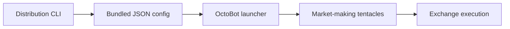
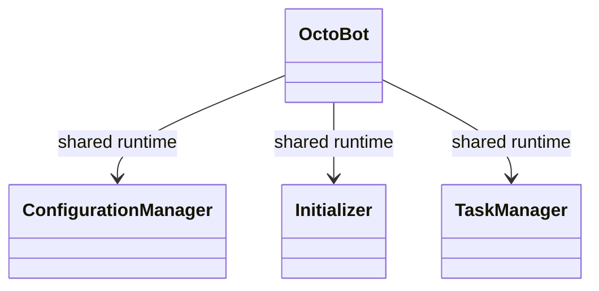
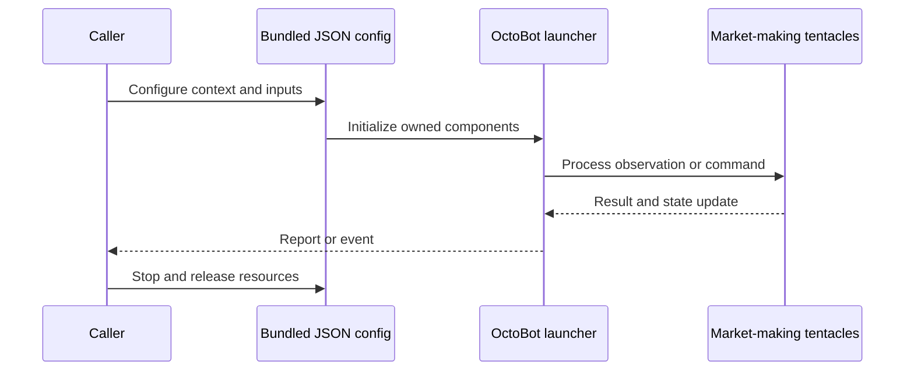
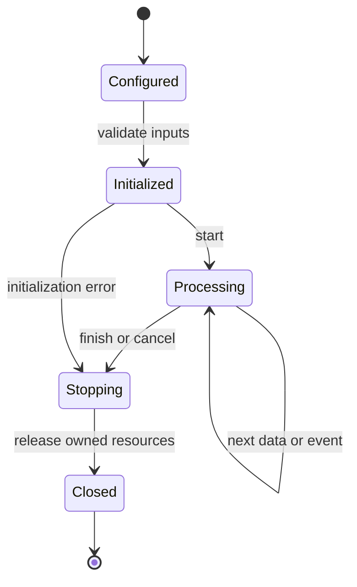
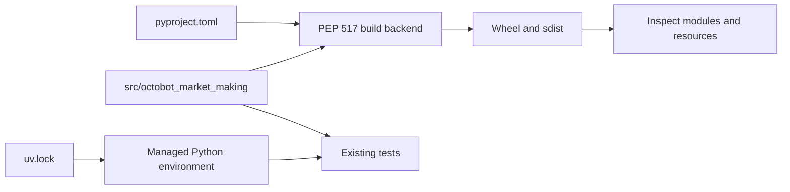
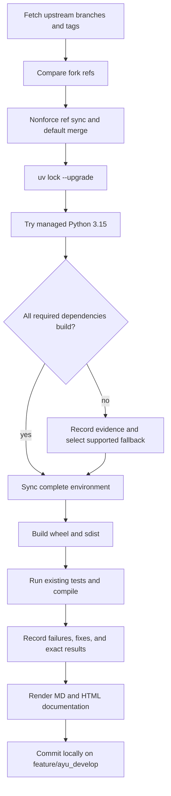

# OctoBot-Market-Making: architecture and development

Market Making is a small OctoBot distribution launcher. It chooses a default distribution/profile configuration and delegates the runtime to OctoBot; the quoting algorithms live in tentacles and the shared trading runtime.

## Components and boundaries

The console entry point forwards command-line arguments and a package-local default_config_file to octobot.cli.main. Constants resolve resources relative to __file__, which keeps configuration discoverable after src-layout installation. The distribution configuration selects services, exchange settings, and market-making profile behavior. Container launch files provide another entry point into the same application.

The following class view names implementation classes. Cross-package types are supplied by the host ecosystem; arrows describe inheritance or usage, not copied ownership.

## Runtime workflow

Launch the distribution entry point, resolve bundled JSON configuration, forward arguments to OctoBot, load the selected profile/plugins, initialize exchange producers and trading modes, then run their asynchronous lifecycle. Backtesting and paper-trading behavior are delegated to OctoBot.

This sequence is an architectural view of responsibility and resource ownership. Individual plugin, connector, and strategy implementations can add asynchronous events and error branches. The lifecycle below is a conceptual operating workflow, rather than a claim that every component has one shared state enum.

## Features and extension points

Packaged market-making defaults; command-line launcher; Docker/Compose deployment examples; profile-driven quoting configuration; inherited OctoBot simulation and services.

Extend the owning component behind its existing public interface. Keep metadata and configuration alongside plugin/strategy resources. Exchange-specific behavior belongs in an adapter; strategy decisions belong in the strategy/evaluator layer; persistence schema and migrations belong with the storage implementation. Review the source map below before changing a boundary, and exercise the existing tests associated with that boundary.

## Packaging and dependency design

The class diagram names externally owned OctoBot classes; this repository defines no independent runtime classes. The sibling OctoBot uv source ensures the launcher is checked against the merged core rather than an old published wheel. Bundled resource paths remain package-relative.

The lock records exact package versions, hashes, platform markers, and local source mappings. Path sources deliberately bind related repositories in this workspace; clone sibling repositories at the documented names before synchronization. Published packaging metadata describes public dependencies, while uv source settings select this development workspace. Resolve dependency changes with uv lock --upgrade and retain the generated lock, then verify the same locked environment.

## Maintenance workflow

All upstream branches and tags are fetched. Fork updates use nonforce pushes; a divergent branch is merged without erasing fork history. The default branch is merged into feature/ayu_develop with package/resource conflicts reconciled in their installed locations. Build and test evidence is recorded before a local maintenance commit. Feature branch publication is a separate root-level action.

No existing test assertions are removed and no new test cases are introduced in this maintenance pass. Corrected fixtures preserve coverage while making paths, corruption inputs, and resource cleanup compatible with the selected interpreter. A failed test or unsupported dependency is reported explicitly in [validation](validation.md); package build success does not imply strategy correctness, profitability, or successful live connectivity.

## Source map

| Source | Responsibility and location |
| --- | --- |
| [cli.py](../src/octobot_market_making/cli.py) | src/octobot_market_making/cli.py |
| [constants.py](../src/octobot_market_making/constants.py) | src/octobot_market_making/constants.py |
| [__init__.py](../src/octobot_market_making/__init__.py) | src/octobot_market_making/__init__.py |
| [default_config.json](../src/octobot_market_making/config/default_config.json) | src/octobot_market_making/config/default_config.json |
| [README.md](../src/octobot_market_making/README.md) | src/octobot_market_making/README.md |
| [start.py](../start.py) | start.py |
| [Dockerfile](../Dockerfile) | Dockerfile |
| [docker-compose.yml](../docker-compose.yml) | docker-compose.yml |
| [cli_test.py](../tests/cli_test.py) | tests/cli_test.py |
| [pyproject.toml](../pyproject.toml) | pyproject.toml |
| [README.md](../README.md) | README.md |
| [uv.lock](../uv.lock) | uv.lock |

## Further reading

Use [development.md](development.md) for reproducible commands and [validation.md](validation.md) for exact interpreter, dependency, build, test, and blocker evidence. The equivalent [HTML architecture document](ayu-develop.html) supports browsing and rendered diagrams.

Python 3.15 now builds with [the documented current native source and system-library settings](development.md#current-native-indicator-source). This repository’s own 1 original CLI case passes. The original assertions and API scope remain intact.
